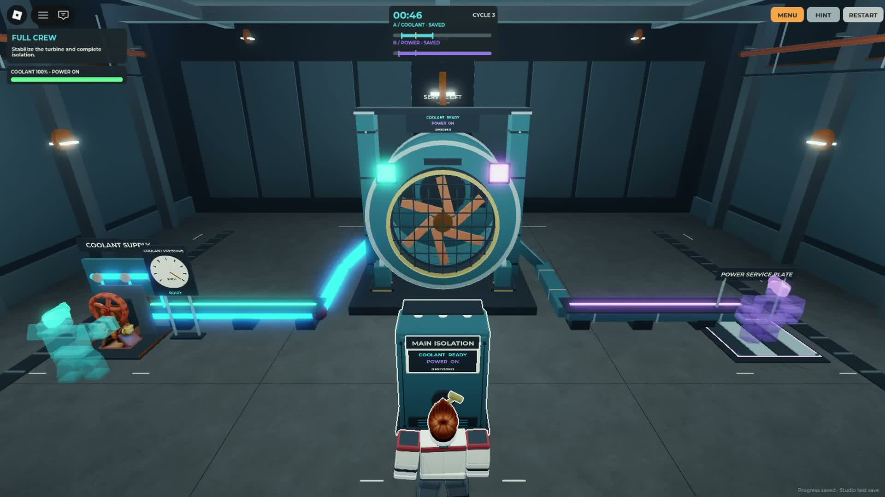
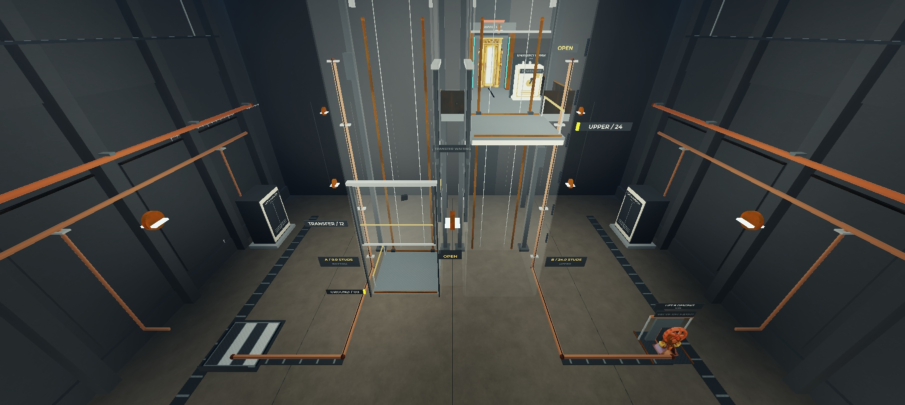

# Loopbreaker Maintenance — QA Case Study

Loopbreaker is a single-player Roblox puzzle game. Players record their actions, rewind a 60-second cycle, and work alongside echoes of their earlier attempts.

[Play Loopbreaker Maintenance on Roblox](https://www.roblox.com/games/137449386560771)

*Archived Studio gameplay from Chamber 05, Full Crew. Two echoes supply coolant and power while the technician operates isolation.*

## 60-second summary

| Area | Result |
|---|---|
| Role | Game developer and QA contributor. Reproduced player reports, defined acceptance criteria, verified fixes, and documented remaining risks. |
| Build | Roblox place version **41** for the current Studio smoke test. Earlier runs are labeled by build and date. |
| Chamber handoff | **341 Studio transition checks passed, zero falls.** All 11 boundaries were covered under three network profiles. |
| Puzzle regression | **12 of 12 chambers solved** by an automated driver that walked the actual routes and used server-validated device actions. |
| Saves and replay | **31 isolated-backend checks passed.** On v41, solving Chamber 01 unlocked replay and advanced Continue to Chamber 02. Replaying Chamber 01 preserved that checkpoint. |
| Release confidence | Focused Studio evidence supports the fixes. Live network reliability, real account reconnects, and physical-device acceptance remain open. |

## Featured defects

| Defect | Impact and retest |
|---|---|
| [LB-001 · Falls after chamber exits](defects/LB-001-chamber-handoff.md) | A player could reach the destination before its floor arrived. Verified the readiness handshake under lag, jitter, packet loss, and delayed loading in Studio. |
| [LB-002 · Solved chambers missing from menus](defects/LB-002-chamber-replay.md) | Completion records were inaccessible from the title and desktop pause menus. Completed a repair, replayed it from the menu, and verified the campaign checkpoint survived. |
| [LB-003 · Unresponsive controller input](defects/LB-003-gamepad-controls.md) | Controller players lacked menu focus and gameplay bindings. Verified initial navigation and a server-accepted coolant hold in the Studio Controller Emulator on v35. |

## How the checks worked

The transition fixtures staged a solved room, then had a colliding avatar walk through its real exit. This isolated loading from puzzle execution. The puzzle regression started with baseline machinery and created recordings through normal routes and validated controls. Save tests used an in-memory backend to check progress across service instances.

*Archived Studio environment capture from Chamber 08, The Transfer. It shows the route used for lift and pause testing.*

## Explore the evidence

| Artifact | Contents |
|---|---|
| [Test plan](test-artifacts/test-plan.md) | Risk priorities, test design, and manual retest steps |
| [Test cases](test-artifacts/test-cases.csv) | Executed results, missed targets, and scenarios still to run |
| [Traceability matrix](test-artifacts/traceability.csv) | Player requirements mapped to test cases |
| [Evidence index](evidence/README.md) | Run data, screenshot provenance, and current-build smoke |
| [Release summary](case-study/release-summary.md) | What the results support and what remains open |

[Earlier QA case study for Color Collapse](https://github.com/jjjjavad/color-collapse-qa-portfolio)
